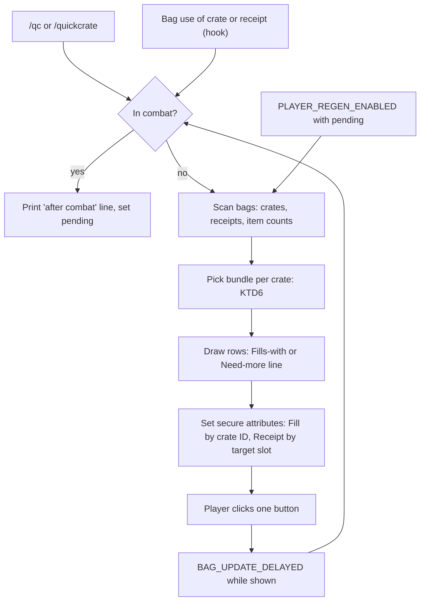
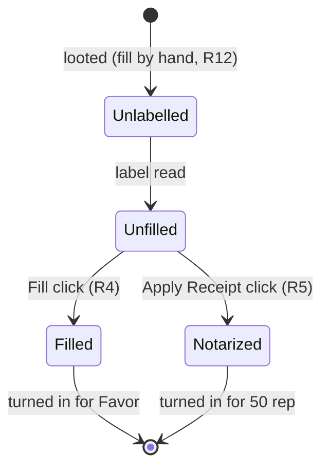

# QuickCrate Addon - Plan

## Goal Capsule

- **Objective:** A WoW Forever player can fill each Waylaid Crate, or put a Forged Delivery Receipt on it, with one click in a small window. Before clicking, they can read exactly which material the fill will use.
- **Means:** A wowlua addon project, tested in wowlua's emulated client and installed into the game with `wowlua dev` (KTD1). Fills and receipts go through secure action buttons (KTD4, KTD5).
- **Authority:** This plan's Product Contract governs behavior. Where an in-game finding from U1 contradicts an assumption here, the finding wins and the affected KTD is updated in place.
- **Execution profile:** One PR (or one series of commits on `main`, since the repo has no remote yet). Five units, in the order U1 → U2 → U3/U4 → U5.
- **Stop conditions:** Stop and ask if the U1 probe shows a fill can't be started by a secure item use, for example if the game requires a gossip or NPC interaction. That would break R4.
- **Who finishes:** The implementer builds and tests the addon. The player does the in-game checks the Verification Contract marks as in-game.

---

## Product Contract

### Summary

QuickCrate is a standalone addon. It opens a small window listing the Waylaid Crates in your bags. Each crate row has a Fill button and a line naming the material and count the fill will use. A second section lets you put a Forged Delivery Receipt on any unfilled crate with one click. The window opens with `/qc` or `/quickcrate`, or by itself when you use a crate or receipt from your bags.

### Problem Frame

Merchant's Favor and the Durotar Supply and Logistics / Azeroth Commerce Authority reputation come from turning in Waylaid Crates. Each crate takes one of several material bundles, for example 20 Copper Ore or 20 Tin Ore. Today the player has to check which bundle their bags can cover, then use the crate. After Friendly, a Forged Delivery Receipt (15 Favor) turns an empty crate into a Notarized Shipping Container worth 50 rep, and applying it means targeting the crate by hand. Doing this for a stack of crates is slow, and it's easy to burn the wrong materials. Existing addons (Inri's WritMaster, Crafter's Journal, NaowhForever) plan which crates to buy and price them, but none of them does the filling itself.

### Key Decisions

- **One click per crate or receipt.** WoW only allows an item use from a hardware click, so a bulk fill isn't possible. (session-settled: user-approved — chosen over a multi-crate "fill all" button: the client blocks unattended item use.) Governs R4, R6.
- **A receipt can go on any unfilled crate.** (session-settled: user-directed — chosen over restricting receipts to particular crate tiers: the player confirmed receipts accept any unfilled crate.) Governs R5.
- **Each fill row says what it will use.** (session-settled: user-directed — chosen over a bare Fill button: the player wants to see which material will be consumed before clicking.) Governs R2, R3.

### Requirements

**Crate filling**

- R1. The window lists every Waylaid Crate in the player's bags that has a known bundle table, one row per crate item ID, with its name, icon and how many the player holds.
- R2. Each crate row shows a line naming the material and count the next Fill click will use, for example "Fills with 20× Copper Ore".
- R3. When the bags cover none of a crate's bundles, the row's line names the bundle closest to complete and what is missing (for example "Need 6 more Tin Ore"), and the Fill button is disabled.
- R4. One click on Fill fills one crate. The row updates to the new counts once the bags settle.

**Receipts**

- R5. When the player holds a Forged Delivery Receipt, each unfilled crate row offers an Apply Receipt button that puts one receipt on that crate with one click.
- R6. The receipt section shows how many receipts the player holds. With receipts but no unfilled crates, it says so.

**Opening and window**

- R7. `/qc` and `/quickcrate` toggle the window.
- R8. The window opens by itself when the player uses a Waylaid Crate or a Forged Delivery Receipt from their bags, whichever bag addon they use. It does not close or re-toggle when it is already open.
- R9. The window is small and movable, and it remembers its position between sessions.

**Safety and limits**

- R10. A QuickCrate button never uses any item other than a Waylaid Crate or a Forged Delivery Receipt, even when the bags changed since the window last refreshed.
- R11. In combat the window doesn't open or rebuild its buttons. Asking for it prints one chat line saying it will be available after combat.
- R12. Bag items named "Waylaid …" that have no bundle table, such as the unlabelled Waylaid Crate or single-item Waylaid Supplies, are listed as "fill by hand" with no buttons.

**Packaging**

- R13. The addon is titled QuickCrate, lists Theliahh as author, and targets the WoW Forever client (wowlua flavor `camelot`, Interface 16001).

### Acceptance Examples

- AE1. Covers R2, R3. **Given** an Apprentice Ore crate and 25 Tin Ore with no Copper Ore, **then** the row reads "Fills with 20× Tin Ore". **Given** only 14 Tin Ore, **then** it reads "Need 6 more Tin Ore" and Fill is disabled.
- AE2. Covers R10. **Given** the window was drawn with a crate in bag 1 slot 4, and the player then moved a potion into that slot, **when** they click Fill, **then** a crate (found by item ID) is used and the potion is not.
- AE3. Covers R8. **Given** the window is closed, **when** the player right-clicks a Forged Delivery Receipt in EllesmereUI Bags, **then** the window opens with the receipt section visible.

### Scope Boundaries

- No shopping lists, auction house prices, Favor-per-gold or reputation planning. WritMaster and Crafter's Journal cover these.
- No waypoints or turn-in help for Dokimi or Marcy Baker.
- No automation for unlabelled crates or Waylaid Supplies (R12).
- No auto-open when a crate or receipt is used from an action bar. Only bag uses are hooked (KTD7). Considered and not built: action-bar crates are rare, and catching them would mean hooking `UseAction` and resolving slots. Revisit if players report using crates from bars.
- No localized name matching for R12. The "Waylaid" prefix is matched in English only. Considered and not built: WoW Forever's player base plays the English client. Revisit if a localized client appears.
- Considered and not built: a confirmation prompt before Fill. The row's "Fills with" line (R2) already shows what will be used, and a second prompt would double the clicks.

### Sources

- Crate→bundle data, generated from each crate's Stock Crate spell by other addons: `AddOns/NaowhForever_QoL/Loot/WaylaidCratesData.lua` (30 crates, item IDs 248682–248713, build 1.60.1.70888) and `AddOns/CraftersJournal/Data/Crates.lua`. Unlabelled crates and Waylaid Supplies are absent there as well (`AddOns/NaowhForever_QoL/README.md`, Waylaid Crate Prices section).
- Forged Delivery Receipt item 262902 and its effect: `AddOns/InriWritMaster/Data.lua` (vendor list and help text).
- wowlua testing and project layout: the wowlua docs `guide/testing.md`, `guide/getting-started.md` (`northshire` WoW Forever profile, `mock.setBag`, `mock.defineItem`, `mock.slash`, `mock.click`).

---

## Planning Contract

### Key Technical Decisions

- KTD1. **wowlua project in `D:\Dev\QuickCrate`, installed by `wowlua dev`.** The source lives outside `AddOns`. wowlua generates the TOC from `wowlua.json`, runs tests in its emulated client, and copies the build into `AddOns/QuickCrate`. (session-settled: user-directed — chosen over plain Lua edited in place in `AddOns/QuickCrate`: emulated-client tests and a generated TOC need wowlua to own the install folder.)
- KTD2. **Source in typed `.wowlua` modules, tests in `tests/*.test.wowlua`.** Tests import modules by path (`/inventory`), which keeps the bag-scan logic testable without the UI. The release build bundles everything into one Lua file, so the module split costs nothing in game.
- KTD3. **QuickCrate carries its own crate table, keyed by item ID.** The table maps crate ID to its bundles in game order. Item names come from `C_Item` at runtime, with English fallbacks for uncached items. The table is checked against both existing generated tables at authoring time. It doesn't depend on NaowhForever being installed.
- KTD4. **Fill is a `SecureActionButtonTemplate` button that uses the crate by item ID, then targets the chosen bundle's material with `target-item`.** In game, using a crate only starts the fill: the game then waits for the player to pick the material, so one click must do both steps. Blizzard's secure button (`Blizzard_FrameXML/SecureTemplates.lua`, `OnActionButtonClick`) targets `target-item` in the same click whenever the used item is waiting for an item target. Using the crate by ID means a stale bag/slot can't make the button use a different item, which satisfies R10. If the crate only asks for its target after a cast, the click can't reach the material. In that case the button arms for a second click: while the game waits for an item target within 3 seconds of a Fill click, the button drops its crate and reads "Put in", so the next click targets the material alone. It returns to Fill when targeting ends. If filled or notarized crates turn out to keep the unfilled crate's item ID, Fill switches to a bag/slot target that `PreClick` re-checks, the same way KTD5 does.
- KTD5. **Apply Receipt is a secure button that uses item 262902 with `target-bag`/`target-slot` set to an unfilled crate.** The insecure `PreClick` re-resolves the target to a current unfilled crate of that row's ID, out of combat only. If the target goes stale anyway, the worst case is that the game rejects the target. Patterns: `AddOns/NaowhForever_Professions/UI/Disenchant.lua` (macro plus target attributes) and `AddOns/EllesmereUIBags/EllesmereUIBags_QuickActions.lua`.
- KTD6. **The bundle named in the "Fills with" line is the one the game will consume.** U1 finds out how the game picks a bundle. Until then the working rule is "the first bundle, in the table's game order, that the bags fully cover". If U1 shows the player picks the bundle in a game dialog, the line names the first coverable bundle and the dialog does the rest.
- KTD7. **Auto-open hooks `C_Container.UseContainerItem` with `hooksecurefunc`, filtered to crate and receipt IDs.** Every bag addon, Blizzard's and EllesmereUI Bags included, ends up in that function. The same hook is used by `AddOns/NaowhForever_Market/Ledger.lua`, `AddOns/Spoken_Readables/Opener.lua` and `AddOns/RXPGuides/HSBatching.lua`. QuickCrate's own secure buttons may or may not pass through the hook, depending on how the secure template uses the item. Either way it's harmless, because opening is idempotent (R8).
- KTD8. **Refresh on `BAG_UPDATE_DELAYED` while the window is shown. Secure attribute writes wait for `PLAYER_REGEN_ENABLED`.** Rows rebuild from a fresh bag scan. Protected buttons can't be shown or changed in combat, so combat sets a pending flag instead (R11).
- KTD9. **`QuickCrateDB` (account SavedVariables) stores only the window position.** Nothing else needs to persist.

### High-Level Technical Design

How a trigger becomes a click-ready window:



Crate lifecycle as QuickCrate sees it (U1 confirms which transitions change the item ID):



### Output Structure

```text
QuickCrate/
  wowlua.json            manifest: title, author Theliahh, flavor camelot, SavedVariables
  wowlua.lock
  src/
    data.wowlua          crate table, receipt ID, fallback names
    inventory.wowlua     bag scan and bundle choice (pure logic)
    window.wowlua        frame, crate rows, receipt section
    triggers.wowlua      slash commands, use hook, events, combat gate
    debug.wowlua         /qc debug probe
    main.wowlua          wiring and SavedVariables
  tests/
    profiles/crates.json
    inventory.test.wowlua
    window.test.wowlua
    triggers.test.wowlua
  docs/plans/            this plan, never shipped
  README.md
  CHANGELOG.md
```

---

## Implementation Units

### U1. Project scaffold and in-game probe

- **Goal:** Create a buildable, installable wowlua project, then answer the in-game questions KTD5 and KTD6 depend on.
- **Requirements:** R13, and the evidence R2, R5, R12 need.
- **Dependencies:** None.
- **Files:** `wowlua.json`, `src/main.wowlua`, `src/debug.wowlua`, `README.md`, `CHANGELOG.md`, `.gitignore`, `tests/triggers.test.wowlua`.
- **Approach:**
  1. Scaffold the wowlua project directly in the existing repo folder `D:\Dev\QuickCrate` with flavor `camelot`, not in a nested subfolder. Use `wowlua new` aimed at that folder, or `wowlua init` if `new` refuses a folder that already exists. Set `addon.title` to QuickCrate, `package.authors` to `["Theliahh"]`, and `QuickCrateDB` as SavedVariables. Make sure `docs/` isn't part of the build.
  2. Add `/qc debug`. For each Waylaid item and receipt in the bags, it prints the item ID, name, the use spell (`C_Item.GetItemSpell`) and the bag/slot. While the debug mode is on, it also logs `UNIT_SPELLCAST_SENT`, `CURRENT_SPELL_CAST_CHANGED`, `GOSSIP_SHOW` and any `StaticPopup` shown after a crate or receipt use.
  3. Install with `wowlua dev`. In game, fill one crate when its bags cover two bundles, fill one when they cover one, and apply one receipt. Record in the plan's Open Questions: which bundle was consumed, whether the crate's item ID changed after filling or receipting, the order of the receipt flow, and the unlabelled crate's item ID.
- **Execution note:** The in-game probe gates U2's bundle rule and U4's target rule. Do it before finishing those units, and update KTD5/KTD6 in place with what it shows.
- **Patterns to follow:** The wowlua `getting-started` template layout.
- **Test scenarios:**
  - `/qc debug` with an Apprentice Ore crate (248683) and a receipt (262902) defined in bag 0 prints one line for each, with its ID and slot.
  - `/qc debug` with no Waylaid items prints a single "nothing to report" line.
- **Verification:** `wowlua build` and `wowlua test` pass. `/reload` in game loads QuickCrate with no errors, and the AddOns list shows Theliahh as author. The four probe answers are recorded in this plan.

### U2. Crate data and bag inventory model

- **Goal:** Pure logic that turns bag contents into crate rows: which crates are present, which bundle the next fill uses or what's missing, and which crates can take a receipt.
- **Requirements:** R1, R2, R3, R6, R12.
- **Dependencies:** U1, for the bundle rule and filled-state findings.
- **Files:** `src/data.wowlua`, `src/inventory.wowlua`, `tests/inventory.test.wowlua`, `tests/profiles/crates.json`.
- **Approach:**
  1. `data` holds the 30-crate table (KTD3), the receipt ID 262902, and fallback names.
  2. `inventory` scans `C_Container` once per refresh. It sums counts per item ID across bags and collects crate slots, receipt count and unknown "Waylaid" items.
  3. Bundle choice follows KTD6. The "closest" bundle for R3 is the one with the smallest missing count, with ties going to game order.
  4. Unfilled versus filled crates are told apart using whatever U1 found (a different item ID, or tooltip text).
- **Patterns to follow:** The `fills` / `opts` shape in `AddOns/CraftersJournal/Data/Crates.lua` and `AddOns/InriWritMaster/Data.lua`.
- **Test scenarios:**
  - Covers AE1. Apprentice Ore crate, 25 Tin Ore, no Copper Ore: the chosen bundle is Tin Ore ×20.
  - Covers AE1. Apprentice Ore crate, 14 Tin Ore: no bundle chosen, closest is Tin Ore with 6 missing.
  - Apprentice Ore crate with 20 of both ores: the chosen bundle is Copper Ore, the first in game order.
  - A bundle split across two bags (12 + 10 Linen Cloth): counts sum and the bundle is covered.
  - Three crates of the same ID: one row with count 3.
  - Two receipts and one unfilled crate: receipt count 2, one crate eligible.
  - A bag item named "Waylaid Crate" with an ID not in the table: listed as fill-by-hand, with no bundle.
  - Empty bags: no rows and receipt count 0.
- **Verification:** All inventory tests pass under the `crates` profile. The table's 30 IDs and bundles match `WaylaidCratesData.lua` entry for entry.

### U3. Window and crate rows

- **Goal:** The movable window with one row per crate: icon, name, count, the Fills-with / Need-more line, and a secure Fill button.
- **Requirements:** R1, R2, R3, R4, R9, R10.
- **Dependencies:** U2.
- **Files:** `src/window.wowlua`, `src/main.wowlua`, `tests/window.test.wowlua`.
- **Approach:**
  1. A small frame (about 300 px wide) with a title and a close button, draggable, with its position saved to `QuickCrateDB` (KTD9).
  2. Rows come from a reusable pool. Each Fill button is a `SecureActionButtonTemplate` set to use the crate by item ID (KTD4), and is disabled when no bundle is covered.
  3. A row's text is built only from U2's model, so the tests assert text and attributes without needing a real fill.
- **Patterns to follow:** `AddOns/InriWritMaster/InriWritMaster.lua`'s `Button` helper and row-list construction for a compact window.
- **Test scenarios:**
  - Covers AE1. With the AE1 bags, after `/qc` the row's line reads "Fills with 20× Tin Ore" and the Fill button is enabled.
  - Covers AE1. With 14 Tin Ore, the line reads "Need 6 more Tin Ore" and Fill is disabled.
  - Covers AE2. The Fill button's item attribute names the crate's item ID, not a bag/slot.
  - Two crate kinds in the bags produce two rows, in table order.
  - Dragging the window and reopening it keeps the new position.
- **Verification:** The window tests pass. In game, one Fill click consumes the bundle the line named, and the row updates (R4).

### U4. Receipt section

- **Goal:** Show the receipt count and give each unfilled crate row a secure Apply Receipt button.
- **Requirements:** R5, R6, R10.
- **Dependencies:** U2, U3. U1's receipt-flow finding.
- **Files:** `src/window.wowlua`, `tests/window.test.wowlua`.
- **Approach:**
  1. A header line: "Forged Delivery Receipts: N", or "No unfilled crates" when N > 0 and nothing is eligible.
  2. Per-row Apply Receipt buttons follow KTD5. `PreClick` re-resolves the target slot out of combat. If U1 shows the flow is the other way round (use the crate while a receipt is in the bags), the button uses the crate instead and the header says so.
  3. The section is hidden when the player has no receipts.
- **Test scenarios:**
  - Two receipts, one unfilled crate in bag 1 slot 4: the header reads "Forged Delivery Receipts: 2", and that row's Apply button targets bag 1 slot 4 with item 262902.
  - The crate moves to bag 2 slot 1 before the click: `PreClick` retargets to bag 2 slot 1.
  - One receipt and no unfilled crate: the header reads "No unfilled crates" and no Apply buttons are shown.
  - No receipts: the receipt section is hidden.
- **Verification:** The window tests pass. In game, one Apply click turns a crate into a Notarized Shipping Container and the receipt count drops by one.

### U5. Triggers: slash commands, auto-open, refresh and combat

- **Goal:** Open the window from the slash commands and from bag uses, keep it current, and respect combat lockdown.
- **Requirements:** R7, R8, R11.
- **Dependencies:** U3, U4.
- **Files:** `src/triggers.wowlua`, `tests/triggers.test.wowlua`.
- **Approach:**
  1. Register `/qc` and `/quickcrate` as a toggle. `/qc debug` stays from U1.
  2. Install the KTD7 hook once at login. It opens the window (never toggles it) when the used item is a crate or receipt.
  3. Refresh and the combat gate follow KTD8.
- **Test scenarios:**
  - `/qc` opens the window, a second `/qc` closes it, and `/quickcrate` does the same.
  - Covers AE3. Calling `C_Container.UseContainerItem` on a receipt's bag slot with the window closed opens it.
  - Using a crate while the window is open leaves it open.
  - Using an unrelated item (a Hearthstone) doesn't open the window.
  - In combat, `/qc` prints the after-combat line and the window stays hidden. Leaving combat with the request pending opens it.
  - A `BAG_UPDATE_DELAYED` that removes the last crate of a kind removes that row.
- **Verification:** The trigger tests pass. In game, right-clicking a crate or receipt in EllesmereUI Bags opens the window.

---

## Open Questions

Deferred to implementation. U1's probe answers them. Answers from the first in-game test:

- Bags: the Forever client has a reagent bag (bag 5), and crates and materials can sit there. QuickCrate scans the backpack through `NUM_TOTAL_EQUIPPED_BAG_SLOTS`.
- Fill flow: using a crate does not fill it on its own. The game then waits for the material to be picked. The one-click Fill (crate plus `target-item`) fills the crate in game, so the "Put in" second click is only a fallback (see KTD4).
- Receipt: confirmed in game. One Receipt click casts "Forge Delivery Receipt" (1269600) on the targeted crate and gives a new item, Notarized Shipping Container, with no targeting cursor (KTD5 holds). The notarized container is a different item, so it never counts as an unfilled crate.
- Filled crate: a filled Apprentice Ore crate in the bags did not show in `/qc debug`, so filling turns it into a different item, neither ID 248683 nor named "Waylaid". Fill and Receipt by crate ID can't pick a crate that's already done.
- Bundle choice: with 20 Copper Ore and 20 Tin Ore, Fill showed "Fills with 20× Copper Ore" and the game used the Copper Ore, the material the button targeted. The "Fills with" line names what is actually consumed (KTD6 holds).

Still open:

- Does targeting one stack work when a bundle's material is split across stacks?
- What is the unlabelled Waylaid Crate's item ID, and does reading its label replace it with a labelled crate ID? (Affects R12.)

---

## Risks & Dependencies

| Risk | Mitigation |
|---|---|
| The fill may open a game dialog (StaticPopup or gossip) rather than completing on the click | U1 detects it. The click still starts the fill, and the "Fills with" line stays accurate per KTD6. A fill that requires an NPC is a stop condition |
| WoW Forever's secure templates may handle `target-bag`/`target-slot` differently from retail | Two installed addons already use those attributes on this client. U4's in-game check confirms it |
| wowlua's emulated client may not run secure actions end to end | Tests assert attributes and text. Actual item consumption is checked in game per the Verification Contract |
| The crate table drifts after a game patch adds crates | Unknown crate IDs fall back to fill-by-hand (R12) instead of misbehaving. The table is cross-checked against the generated tables when crates change |

---

## Verification Contract

| Gate | Command or check | Applies to |
|---|---|---|
| Type check | `wowlua check` | Every unit |
| Tests | `wowlua test` | U1–U5 |
| Release build | `wowlua build --release` produces `dist/release/QuickCrate` with a TOC showing Interface 16001 and author Theliahh | U1, final |
| In game | `wowlua dev`, `/reload`, then the unit's in-game verification line | U1, U3, U4, U5 |

---

## Definition of Done

- R1–R13 are met. AE1–AE3 pass as tests, and AE3 is also checked in game.
- The U1 probe answers are recorded in Open Questions, and KTD5/KTD6 reflect them.
- `wowlua check`, `wowlua test` and `wowlua build --release` pass.
- One fill and one receipt application have been done in game through the window without Lua errors.
- `QuickCrate` is installed in `AddOns` by `wowlua dev`, and no source files live there.
- Debug-only experiments other than `/qc debug` are removed. No dead code from abandoned approaches remains.
