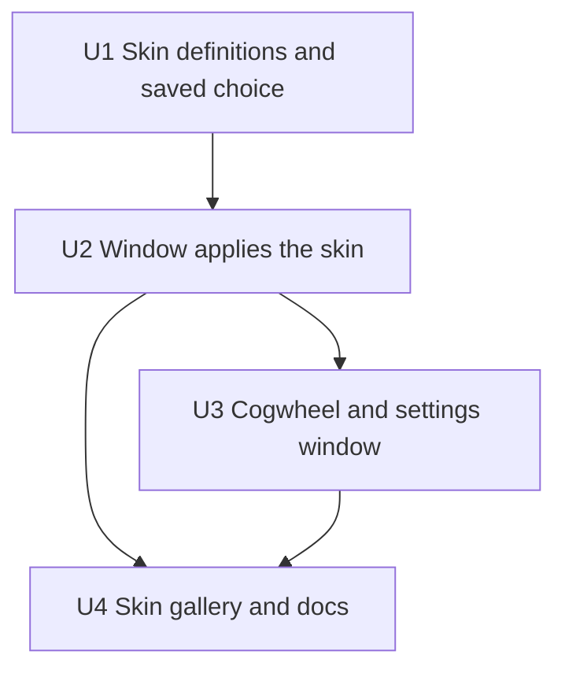

# QuickCrate Skins - Plan

## Goal Capsule

- **Objective:** QuickCrate's window looks like a polished part of the game, and the player can choose between several looks from inside the game.
- **Means:** skins defined as data that the existing window applies to itself, plus a small settings window with a skin dropdown (KTD1, KTD4).
- **Product authority:** this Product Contract. The approved mockups listed under Sources show what each skin should look like. Where a unit and a requirement disagree, the requirement wins.
- **Open blockers:** none.
- **Execution profile:** one change on a feature branch, units U1 → U2 → U3 → U4. The repo is `D:\Dev\QuickCrate` (public at github.com/theliahh/QuickCrate).
- **Stop conditions:** stop and ask if a skin can only reach its mockup look using art that fails to render (shows missing-texture placeholders) in the emulator or the game.
- **Who finishes:** the implementer builds and tests. The player does the in-game visual check (Success Criteria).

---

## Product Contract

### Summary

QuickCrate gets five skins. Metal is the default, and Portrait, Parchment, Slate and Plain are the alternatives. A cogwheel button in the title bar opens a small settings window, and a dropdown there switches the skin immediately and remembers the choice.

### Problem Frame

The current window is a flat dark box with Blizzard's default fonts. Next to the rest of the player's UI (EllesmereUI, NaowhForever, Crafter's Journal) it looks plain and unfinished. The player wants it to look more appealing, and to keep the stock Blizzard red buttons, which they like. Different players also prefer different looks: some like Blizzard-style frames such as Crafter's Journal, others the flat modern panels of NaowhForever and EllesmereUI. A single fixed style can't suit all of them.

### Key Decisions

- **Metal is the default skin.** The player picked it from the mockups. It is the closest match to the Blizzard-style look of Crafter's Journal that this client renders reliably. (session-settled: user-directed — chosen over Portrait, Parchment and Slate as the default: the player's pick from the rendered mockups.) Governs R2.
- **Skins are switchable rather than fixed.** (session-settled: user-directed — chosen over shipping a single new look: the player asked for a settings dropdown offering the other designs.) Governs R1, R5, R6.
- **The plain look stays available.** (session-settled: user-directed — chosen over dropping it: the player asked to keep it as an option.) Governs R1.
- **Stock Blizzard buttons in every skin.** (session-settled: user-directed — chosen over custom flat buttons like NaowhForever's: the player likes the stock buttons.) Governs R1.

### Requirements

**Skins**

- R1. QuickCrate offers five skins (Metal, Portrait, Parchment, Slate and Plain), and every skin keeps the stock Blizzard red buttons.
- R2. A fresh install, or a player who has never chosen a skin, sees Metal.
- R3. Each skin has its mockup's look:
  - **Metal:** bronze metal dialog border over a dark bronze background, with a large centred gold title.
  - **Portrait:** the standard Blizzard portrait window, with a metal frame, a title bar, and a round crate portrait in the top-left corner.
  - **Parchment:** quest-log parchment inside a wooden frame, with dark-ink title and names, and darker green and red for the fill lines so they stay readable on the light background.
  - **Slate:** a flat dark panel with a thin grey border, a thin gold line along the top, and faint stripes on alternate rows.
  - **Plain:** today's look.
- R4. In every skin, crate names drop the "Waylaid Crate:" prefix (for example "Apprentice Ore"), and the window is wide enough that names aren't cut off.

**Settings**

- R5. A cogwheel button in the main window's title bar, next to the close button, opens a small settings window.
- R6. The settings window has a skin dropdown listing the five skins, with the current skin selected.
- R7. Choosing a skin restyles the open main window straight away, without a `/reload`.
- R8. The chosen skin is saved for the whole account and is still in effect after logout, login and `/reload`.
- R9. A skin chosen during combat takes effect on the main window when combat ends. The rest of QuickCrate keeps working in combat as it does today.

### Acceptance Examples

- AE1. Covers R2. **Given** QuickCrate has never been configured, **when** the player opens `/qc`, **then** the window uses Metal.
- AE2. Covers R7, R8. **Given** the window is open in Metal, **when** the player picks Slate in the settings dropdown, **then** the window switches to Slate at once, and it is still Slate after a `/reload`.
- AE3. Covers R9. **Given** the player is in combat with the window open in Metal, **when** they pick Parchment, **then** the window stays Metal until combat ends and then switches to Parchment.

### Success Criteria

- In the live game, each skin looks like its mockup and none shows missing-texture placeholders. The mockups were rendered in wowlua's emulated client, which can't load some of Blizzard's classic texture files, so the live game is where this is confirmed.

### Scope Boundaries

- No settings other than the skin dropdown for now: no scale, opacity, font or colour options.
- No new slash command for settings. The cogwheel is the way in.
- No custom buttons. Every skin uses the stock Blizzard buttons (see Key Decisions).
- No per-character skin choice. One choice covers the whole account (R8).
- Crafter's Journal's exact rock background and gold dialog border are not a separate skin. The emulator couldn't render them, and Metal is the agreed stand-in.

### Dependencies / Assumptions

- Assumed: the settings window follows the selected skin. This wasn't discussed with the player; it can be revisited when the skins are built.
- The skins rely on Blizzard frame art this client ships as atlases (the bronze "Dialog" border, the "PortraitFrameTemplate" and "WoodenNeutralFrameTemplate" frames, and the "heavybronze-frame-background" and "QuestBG-Parchment" backgrounds), all of which rendered in the mockups.

### Sources

- Approved mockups: a contact sheet of all five looks (`_all-designs.png`) plus one PNG per skin, rendered by throwaway wowlua probe tests that restyled the real window. They live in the brainstorm session's temporary scratch folder on the author's machine, and may no longer exist. They aren't needed for planning, and this contract governs any disagreement with them.
- Style references: Crafter's Journal main frame (`AddOns/CraftersJournal/UI.lua`, `CreateMainFrame`: rock background, gold dialog border, Blizzard fonts) and NaowhForever's theme tokens (`AddOns/NaowhForever/Core/Core.lua`, `ns.THEME`: dark panels, 1px border, a single accent colour).
- Current window: `src/window.wowlua`.

Product Contract preservation: Product Contract unchanged.

---

## Planning Contract

### Key Technical Decisions

- KTD1. **A skin is a data definition the window applies to itself; there is still one set of rows and buttons.** Each definition gives its chrome builder, title font and placement, name and fill-line colours, and layout metrics (window width, top, side and bottom padding, row decoration). `render()` reads the active skin's metrics when it positions rows, instead of moving them after the fact as the mockup probes did. Secure buttons are never recreated, so switching skins can't break Fill or Receipt. Governs R1, R3, R7.
- KTD2. **Each skin's chrome is built once, the first time it's used, and switching only shows one chrome and hides the others.** Plain's chrome is today's border and background textures. This keeps switching cheap and lets Plain reproduce the current look exactly. Governs R3, R7.
- KTD3. **Only atlas art and colour textures, never classic file-path textures.** The mockups showed the emulator can't resolve classic paths such as `UI-DialogBox-Border` and `UI-Background-Rock`, while atlases rendered. The skins use the `Dialog`, `PortraitFrameTemplate` and `WoodenNeutralFrameTemplate` nine-slice layouts, the `heavybronze-frame-background` and `QuestBG-Parchment` atlases, and colour textures. Portrait's round icon uses a mask texture over the crate icon (`SetPortraitToTexture` is missing in the emulator). Governs R3.
- KTD4. **The settings window is a plain, non-protected frame with Blizzard's modern dropdown (`WowStyle1DropdownTemplate` filled by `MenuUtil.CreateRadioMenu`).** Its cogwheel uses the `questlog-icon-setting` atlas. Having no secure children means it opens, closes and changes value even in combat. Governs R5, R6, R9.
- KTD5. **Restyling the main window goes through `wowlua:combat`'s `defer` with one key, so only the last skin picked during combat is applied when it ends.** The main window has secure children, so resizing it in combat is blocked. Governs R9.
- KTD6. **The skin is a `skin` field in the existing `QuickCrateDB` settings, defaulting to `metal`.** It reuses the current `saved.bind` defaults, so no version bump or migration is needed. An unknown stored value falls back to Metal. Governs R2, R8.
- KTD7. **The "Waylaid Crate:" prefix is dropped where the window shows names, not in the inventory model.** `scan()` and the `/qc debug` output keep the full item name. Governs R4.
- KTD8. **The settings window takes the active skin's chrome through the same skin definitions.** This follows the assumption recorded under Dependencies / Assumptions.

### Sequencing

---

## Implementation Units

### U1. Skin definitions and saved choice

- **Goal:** the five skins exist as data, and the player's choice is stored with Metal as the default.
- **Requirements:** R1, R2, R3, R8.
- **Dependencies:** none.
- **Files:** `src/skins.wowlua` (new), `src/db.wowlua`, `tests/skins.test.wowlua` (new).
- **Approach:**
  1. `src/skins.wowlua` defines the five skins in dropdown order (Metal, Portrait, Parchment, Slate, Plain), each with a display name, a chrome builder, text styling and layout metrics (KTD1, KTD3).
  2. It also exposes the active skin (stored value, or Metal when the stored value is missing or unknown) and a setter that saves the choice (KTD6).
  3. Colour and size values come from the mockup probe tests while they still exist (see Sources), since those produced the approved looks. Otherwise they follow the descriptions in R3.
- **Patterns to follow:** `src/db.wowlua` (`saved.bind` with defaults); the mockup probe helpers for each skin's chrome.
- **Test scenarios:**
  - With no stored skin, the active skin is Metal.
  - With a stored skin of "slate", the active skin is Slate.
  - With a stored value that isn't a skin ("neon"), the active skin is Metal.
  - The skin list is exactly Metal, Portrait, Parchment, Slate, Plain, in that order.
- **Verification:** skin tests pass. The test seam is the skins module's public functions; it doesn't check how anything looks.

### U2. The window applies the active skin

- **Goal:** the main window draws itself in the active skin, re-dresses when the skin changes, and shows full crate names.
- **Requirements:** R1, R3, R4, R7, R9.
- **Dependencies:** U1.
- **Files:** `src/window.wowlua`, `tests/window.test.wowlua`, `tests/skins.test.wowlua`.
- **Approach:**
  1. Move today's border and background textures into Plain's chrome. Build each skin's chrome on first use, and show only the active one (KTD2).
  2. `render()` takes width, padding and row decoration from the active skin, and takes title font, name colour and the fill-line green and red from it too. Parchment uses its darker ink colours.
  3. Shown names drop the "Waylaid Crate: " prefix (KTD7).
  4. A restyle function, run through `defer` (KTD5), switches chrome and re-renders when the window is open, and is picked up at the next open otherwise.
- **Patterns to follow:** the existing `render()` and `getRow()` in `src/window.wowlua`; the stock Blizzard buttons stay as they are.
- **Test scenarios:**
  - Covers AE1. Fresh install, `/qc`: Metal's chrome is shown and the other skins' chrome is hidden.
  - Every skin: after switching to it, its chrome is shown, the rows sit inside its padding, and the Fill button keeps its crate item attribute.
  - Names: the Apprentice Ore row reads "Apprentice Ore", and a manual "Waylaid Crate" item (unknown ID) still reads "Waylaid Crate".
  - Parchment: the fill line uses the dark green ink, not the bright green.
  - Covers AE3. In combat, switching from Metal to Parchment leaves Metal's chrome shown. After combat ends, Parchment's chrome is shown.
  - Two switches in one combat (Slate, then Portrait) end on Portrait.
  - The existing window tests keep passing in the default skin.
- **Verification:** window and skin tests pass.

### U3. Cogwheel and settings window

- **Goal:** a cogwheel in the title bar opens a small settings window whose dropdown switches and saves the skin.
- **Requirements:** R5, R6, R7, R8, R9.
- **Dependencies:** U2.
- **Files:** `src/settings.wowlua` (new), `src/window.wowlua`, `tests/settings.test.wowlua` (new).
- **Approach:**
  1. Add a cogwheel button next to the close button (KTD4). A click toggles the settings window, which is anchored beside the main window.
  2. The settings window holds a "Skin" label and a dropdown listing the five skins, with the active one checked. Picking one saves it and calls the window's restyle (KTD5, KTD6).
  3. The settings window takes the active skin's chrome (KTD8). It closes when the main window closes.
- **Patterns to follow:** `MenuUtil.CreateRadioMenu` usage in the client's own `Blizzard_Menu`; the close button in `src/window.wowlua`.
- **Test scenarios:**
  - Clicking the cogwheel opens the settings window, and clicking it again closes it.
  - The dropdown's options are the five skins, with Metal checked on a fresh install.
  - Covers AE2. Picking Slate switches the main window to Slate at once and stores "slate".
  - Covers AE3. In combat, the settings window still opens and accepts a pick.
  - Closing the main window also closes the settings window.
- **Verification:** settings tests pass, and the full suite passes.

### U4. Skin gallery and docs

- **Goal:** a repeatable way to see every skin, and the README describes skins.
- **Requirements:** R3, plus the Success Criteria.
- **Dependencies:** U2, U3.
- **Files:** `tests/gallery.test.wowlua` (new), `README.md`, `CHANGELOG.md`.
- **Approach:**
  1. The gallery test opens the window with sample crates (one fillable, one stacked, one short of materials) and receipts, switches to each skin, and writes a screenshot per skin.
  2. The README gains a "Skins" line, and the changelog an entry.
- **Execution note:** this unit's proof is visual. Run the gallery with `--game-data`, look at each image, and confirm it matches its mockup with no missing-texture placeholders before calling U2 done.
- **Test scenarios:** Test expectation: none -- the gallery produces images to look at and asserts only that each skin rendered without errors.
- **Verification:** five gallery images exist and match the mockups.

---

## Verification Contract

| Gate | Command or check | Applies to |
|---|---|---|
| Type check | `wowlua check` | every unit |
| Tests | `wowlua test` | U1–U3 |
| Gallery | `wowlua test gallery --game-data`, then look at `dist/screenshots/gallery.test.wowlua/` | U2, U4 |
| In game | `wowlua install`, `/reload`, switch through all five skins from the cogwheel | final (Success Criteria) |

---

## Definition of Done

- R1–R9 hold, and AE1–AE3 pass as tests.
- `wowlua check` and `wowlua test` pass, and the gallery shows all five skins matching the mockups.
- In game, each skin renders without missing-texture placeholders, and the choice survives a `/reload`. The player confirms this.
- The mockup probe hacks that moved rows after drawing are not carried into the source. Layout comes from the skin metrics.
