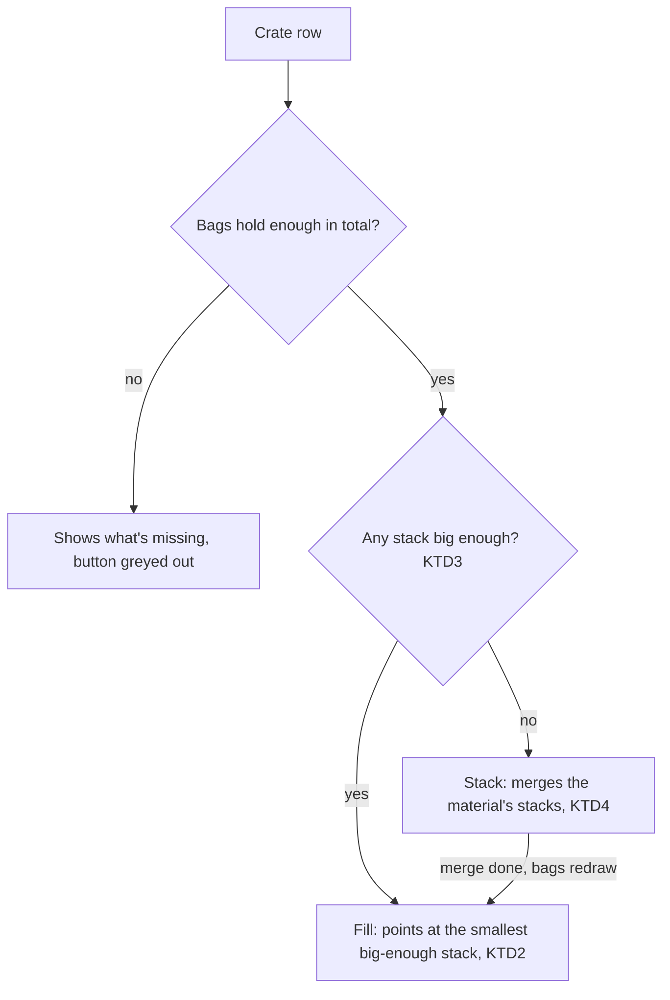
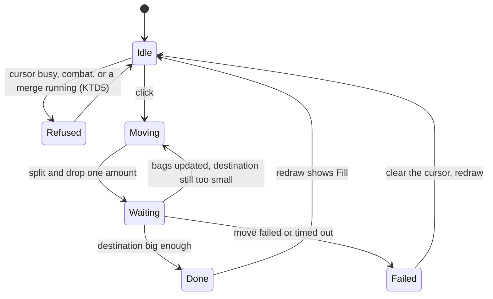

# Stack-Aware Fill - Plan

## Goal Capsule

- **Objective:** whenever QuickCrate says the bags can fill a crate, Fill works, however the material happens to be split across stacks.
- **Means:** Fill points the game at a stack QuickCrate chose, and a one-click Stack step merges stacks first when none is big enough (KTD1, KTD4).
- **Product authority:** this Product Contract. Where a unit and a requirement disagree, the requirement wins.
- **Open blockers:** none. The game's stack rule (KTD3) is checked in game as part of U2's verification.
- **Execution profile:** one PR from `feat/stack-aware-fill`, units U1 → U2 → U3 → U4. The repo is `D:\Dev\QuickCrate` (public at github.com/theliahh/QuickCrate). Merging to `main` publishes a release automatically (see README, Releasing).
- **Stop conditions:** stop and report if, in game, pointing Fill at a stack that holds the bundle's full amount still gives the "not enough" error. Stop too if addon code can't move bag items in this client (U3). In either case the design below doesn't hold.
- **Who finishes:** the implementer builds and tests. The player runs the in-game checks (Success Criteria) before merging.

---

## Product Contract

### Summary

Fill stops leaving the choice of stack to the game. QuickCrate picks a stack big enough for the bundle and points the game at it, so Fill stays one click. When no single stack is big enough but the bags hold enough in total, the row's button reads Stack: one click merges that material's stacks, and the button goes back to Fill.

### Problem Frame

Fill tells the game to target the material by name, and the game picks the stack itself. When it picks a leftover stack smaller than the bundle, the game refuses with a "not enough" error even though the bags hold plenty. The player's example is Waylaid Crate: Expert Parts, which takes 8 Iron Struts. Struts stack to 20, so after two crates a 4-strut stack is left over, and the third Fill fails on it. QuickCrate's own count says the crate can be filled, so the row offers Fill and then fails. The player can't tell what went wrong or fix it from the window. The original addon plan left this as an open question ("Does targeting one stack work when a bundle's material is split across stacks?", `docs/plans/2026-11-23-1326-feat-quickcrate-addon-plan.md`); this report answers it.

### Key Decisions

- **Merging stacks takes its own click.** The row's button reads Stack, and the click after that is the normal Fill. (session-settled: user-approved — chosen over moving items automatically when the window draws: moving bag items without a click would surprise the player mid-fill.) Governs R3.
- **Nothing here has to work in combat.** The player has no use for QuickCrate in combat. (session-settled: user-directed — chosen over making Stack combat-safe: "There's no real use-case for this addon to be used in combat.") Governs R7.

### Requirements

**Filling**

- R1. When a row offers Fill, clicking it fills the crate however that bundle's material is split across stacks.
- R2. When at least one stack is big enough (R4), Fill stays a single click, with no extra step.
- R3. When no stack is big enough but the bags hold enough of the material in total, the row's button reads Stack. One Stack click merges that material's stacks until one is big enough, and the button then reads Fill again.
- R4. A stack is big enough when it holds the bundle's full amount, or a full stack when the bundle needs more than one stack holds (the 40-cloth and 45-core bundles).

**Safety**

- R5. Stack only moves the bundle's own material between that material's stacks. It never moves any other item, and it never leaves an item on the cursor, even when a move fails.
- R6. The addon plan's R10 still holds: a QuickCrate button never uses an item other than a Waylaid Crate or a Forged Delivery Receipt, even when the bags changed since the window last drew.
- R7. In combat, Stack does nothing. The window's existing combat behavior is unchanged.

### Acceptance Examples

- AE1. Covers R1, R2. **Given** an Expert Parts crate, a stack of 4 Iron Struts and a stack of 20, **when** the player clicks Fill, **then** the crate is filled from the 20-stack in one click.
- AE2. Covers R3, R4. **Given** an Expert Parts crate, a stack of 4 Iron Struts and a stack of 6, **then** the row's button reads Stack. **When** the player clicks it, **then** the stacks merge into one of 10 (or 8 and 2), and the button reads Fill.
- AE3. Covers R4. **Given** an Apprentice Textiles crate and two full stacks of 20 Linen Cloth, **then** the row offers Fill, with no Stack step.
- AE4. Covers R5. **Given** the player is holding an item on the cursor, **when** they click Stack, **then** nothing moves, and the item stays on the cursor.

### Success Criteria

- In game, the player's Iron Strut case (AE1) and a forced 4 + 6 split (AE2) both end with a filled crate and no error, with no bag rearranging by hand.

### Scope Boundaries

- Which bundle a crate uses doesn't change. QuickCrate still picks the first bundle, in game order, that the bags can cover, even when a later bundle wouldn't need a Stack click.
- No general bag sorting or tidying. Stack touches only the one material, and only until one stack is big enough.
- Considered and not built: retrying a failed merge automatically. One click either succeeds or leaves the bags as they are, and the row redraws either way, so the player can click again. A retry would only matter if merges failed often in practice.
- Considered and not built: a confirmation before Stack moves items. The button is labelled, and it only stacks the material the row already names.

### Sources

- `Blizzard_FrameXML/SecureTemplates.lua`, `OnActionButtonClick` (camelot client, in wowlua's Blizzard UI cache): when the used item waits for an item target, `target-bag` + `target-slot` target that exact bag slot, and `target-item` is read only when no slot is set.
- `Blizzard_APIDocumentationGenerated/ContainerDocumentation.lua`: `C_Container.PickupContainerItem` and `C_Container.SplitContainerItem` exist in this client. Blizzard's own bag, bank and equipment code calls `PickupContainerItem` from normal UI code.
- Stack sizes from the emulator's game data: every bundle item reports a stack of 20, and five bundles need more than that (Linen, Silk, Mageweave and Runecloth at 40, Gold Power Core at 45). The game must take those from several stacks, which is why R4 caps "big enough" at a full stack. The emulator may report 20 as a default, so U1 reads the real stack size from the client.

---

## Planning Contract

### Key Technical Decisions

- KTD1. **Fill points at a chosen stack with `target-bag` and `target-slot`, not `target-item`.** Blizzard's secure button prefers a set slot over `target-item` (Sources), so this needs no new secure code. The receipt button already works this way, including re-choosing its slot in `PreClick` when the bags have changed (`retargetReceipt` in `src/window.wowlua`). Fill copies that pattern. The crate itself is still used by item ID, so R6 holds: a stale slot can only be offered as the crate's target, and the game rejects a wrong target without using it. Governs R1, R2, R6.
- KTD2. **The chosen stack is the smallest stack that is big enough.** Using partial stacks first leaves full stacks whole, so fewer Stack clicks are needed later. Ties go to the first stack in bag order.
- KTD3. **"Big enough" means at least the smaller of the bundle's amount and the item's maximum stack size.** The maximum comes from the client's item info. When the client hasn't loaded it yet, the bundle's amount is used, so the row can show Stack too early but never Fill too early. This is the game rule this plan assumes; U2's in-game check confirms it (Goal Capsule, stop conditions). Governs R4.
- KTD4. **Stack merges by splitting from source stacks onto one destination stack, one move at a time.** The destination is the largest stack of the material. The sources are the other stacks, largest first, so the merge takes as few moves as possible. Each move splits exactly the amount still needed (capped by the source's count and the destination's free room) and drops it onto the destination. The next move waits until the bags report the change, because a moved stack stays locked, and a split stack's data arrives late, until the server answers. The merge stops when the destination is big enough (KTD3), or when a move fails or times out. On failure it clears the cursor so the item returns to its bag. Governs R3, R5.
- KTD5. **Stack refuses to start when the cursor holds anything, in combat, or while another merge is running.** Those are the cases where a move could drop the player's own item or fight a second merge. Governs R5, R7.
- KTD6. **The inventory scan decides each row's state; the window only shows it.** `scan()` already decides which bundle a crate uses. It now also reports the chosen stack (KTD2) or that the bundle needs stacking. This keeps the rule testable without frames, the way `tests/inventory.test.wowlua` tests bundle choice today.

### High-Level Technical Design

How a row decides what its button does:

A Stack click's lifecycle:

### Sequencing

U1 gives the scan its new answers. U2 and U3 both read them, and U3's button state builds on U2's Fill changes in the same row code, so U2 lands before U3. U4 documents the result.

---

## Implementation Units

### U1. The scan reports the stack Fill should use

**Goal:** For each crate row with a covered bundle, the scan reports either the stack Fill should point at or that the bundle needs stacking.

**Requirements:** R1, R2, R3, R4 (KTD2, KTD3, KTD6)

**Dependencies:** none

**Files:**
- `src/inventory.wowlua`
- `tests/inventory.test.wowlua`

**Approach:**
1. While scanning, keep each item's stacks (slot and count) alongside the totals the scan already keeps.
2. For a crate with a covered bundle, find the smallest stack that is big enough (KTD2, KTD3). Report it as the row's material stack, or mark the row as needing stacking when there is none.
3. Read the maximum stack size from the client's item info. Fall back to the bundle's amount when it isn't loaded (KTD3).
4. Expose the same stack choice for a single item, so U2's `PreClick` can re-choose a stack from fresh bags without rebuilding the whole model.

**Patterns to follow:** `coveredBundle` and `closestBundle` in `src/inventory.wowlua`; how `slotsByID` collects slots per item.

**Test scenarios:**
- Covers AE1. A stack of 4 and a stack of 20 Iron Struts for an 8-strut bundle: the row points at the 20-stack.
- Stacks of 12 and 20 for an 8 bundle: the row points at the 12-stack (smallest big enough).
- Two stacks of 8 for an 8 bundle: the row points at the first in bag order.
- Covers AE2. Stacks of 4 and 6 for an 8 bundle: the row needs stacking and points at no stack.
- Covers AE3. Two full stacks of 20 Linen for a 40 bundle: the row points at a full stack and doesn't need stacking.
- Stacks of 15, 15 and 10 Linen for a 40 bundle: the row needs stacking (no full stack).
- A bundle the bags can't cover: no stack, no stacking flag, and the existing shortfall is unchanged.
- The material spread across two bags, including the reagent bag: stacks in both are considered.

**Verification:** the new inventory tests pass, and the existing bundle-choice tests pass unchanged.

### U2. Fill points at the chosen stack

**Goal:** Fill targets the stack U1 chose, so the game can't pick a stack that is too small.

**Requirements:** R1, R2, R6 (KTD1)

**Dependencies:** U1

**Files:**
- `src/window.wowlua`
- `tests/window.test.wowlua`

**Approach:**
1. When a row draws, set the Fill button's `target-bag` and `target-slot` to the row's material stack. Keep `target-item` set too, as the fallback the secure button reads when no slot is set.
2. Add a `PreClick` to Fill that re-chooses the stack from the bags as they are now (U1's single-item choice), the way `retargetReceipt` does for receipts. When no stack is big enough any more, clear the slot so the button falls back to `target-item`.
3. Keep the late-target "Put in" path working. Its second click goes through the same targeting, so it now targets the slot too.
4. Update the existing test "Fill uses the crate by item ID, never a bag slot". The crate is still used by item ID, and `target-bag` is now expected to hold the material's bag. Rename the test so it says which item uses an ID and which uses a slot.

**Patterns to follow:** `retargetReceipt` and the receipt button's `PreClick` in `src/window.wowlua`; `showCrate` for where row attributes are set.

**Test scenarios:**
- Covers AE1. Stacks of 4 and 20 Tin Ore with an Apprentice Ore crate: Fill's `target-bag` and `target-slot` point at the 20-stack, and `item` is still `item:248683`.
- The 20-stack is moved to another slot after the window draws: clicking Fill re-chooses the stack, and its target follows to the new slot.
- After the window draws, the bags change so no stack is big enough: clicking Fill clears the slot attributes and leaves `target-item` set.
- The late-target path: after a Fill click, the button arms ("Put in") with the slot attributes still set, and disarms back to Fill as before.
- Fill's `item` attribute is never a bag slot, in any of the scenarios above (R6).

**Verification:** the window tests pass. In game, the player's Iron Strut case (AE1) fills in one click with no error. This is also the check for KTD3's assumed game rule: if a big-enough stack still errors, stop (Goal Capsule).

### U3. The Stack button merges stacks

**Goal:** A row that needs stacking offers Stack, and one click merges the material until one stack is big enough.

**Requirements:** R3, R5, R7 (KTD4, KTD5)

**Dependencies:** U1, U2

**Files:**
- `src/stacker.wowlua` (new)
- `src/window.wowlua`
- `tests/stacker.test.wowlua` (new)
- `tests/window.test.wowlua`

**Approach:**
1. A new `stacker` module owns the merge (KTD4): plan the moves from the material's stacks, run one move, wait for the bags to report it, then repeat until done, failed or timed out. It refuses to start in the KTD5 cases. It also ends, as done, when the destination is a full stack and can take no more. Otherwise a bundle bigger than one stack, read before the client knows the item's stack size (KTD3's fallback), would keep asking for a move that can't happen.
2. When a row needs stacking, the row's main button reads Stack. It must not use the crate: like the armed "Put in" state, it has no `item` attribute, and its click runs the stacker for that row's material and amount.
3. Each move splits the amount off a source stack with `C_Container.SplitContainerItem`, which puts it on the cursor, then drops it on the destination with `C_Container.PickupContainerItem`. On any failure, `ClearCursor` returns a held split to its bag (R5).
4. The window redraws when the merge ends. The bag-update redraw that already exists does this for a successful merge, and the stacker requests one after a failure.
5. While a merge runs, the button is disabled, so a second click can't start another merge.

**Execution note:** Before relying on the emulator, confirm early in game that addon code can split and move a bag stack in this client (Goal Capsule, stop conditions). A one-off `/run` test of a split and drop is enough.

**Patterns to follow:** event-driven waits in `src/triggers.wowlua` (`@event("BAG_UPDATE_DELAYED")`); the combat guard in `watchFill` (`InCombatLockdown`).

**Test scenarios:**
- Covers AE2. Stacks of 4 and 6 Iron Struts, Expert Parts crate: the row shows Stack, the click merges them, and once the bags update the row shows Fill, pointing at a stack of at least 8.
- Stacks of 3, 3 and 3 for an 8 bundle: the merge takes two moves, with the second waiting for the first to land, and ends with one stack of at least 8.
- Stacks of 15, 15 and 10 Linen for a 40 bundle: the merge stops once one stack holds 20, and it doesn't keep moving past a full stack.
- The emulator delays the split stack's data (`mock.setItemDataDelay`): the merge waits for the data and still finishes.
- Covers AE4. An item is on the cursor when Stack is clicked: nothing moves, and the cursor still holds the item.
- In combat, Stack does nothing (R7).
- A move whose bag update never arrives: after the timeout the merge stops, the cursor is empty, and the row redraws.
- A second click while a merge is running is ignored.
- Only the bundle's material moves: other items in the same bags keep their slots and counts (R5).

**Verification:** the stacker and window tests pass. In game, a hand-made 4 + 6 Iron Strut split (AE2) becomes Fill after one Stack click, and the next Fill fills the crate.

### U4. Player docs and changelog

**Goal:** Players learn what Stack does, and the next release's notes say what changed.

**Requirements:** R3

**Dependencies:** U3

**Files:**
- `CURSEFORGE.md`
- `README.md`
- `CHANGELOG.md`

**Approach:**
1. `CURSEFORGE.md` and `README.md`: one line under using the addon saying that when the material is spread over small stacks, the button reads Stack, and one click combines them before Fill.
2. `CHANGELOG.md`: an entry under `## Unreleased` saying Fill now works when a material is split across stacks, with Stack combining them when needed. The release automation turns that section into the release notes.

**Test expectation:** none -- documentation only.

**Verification:** the docs describe the Stack button as built, and `CHANGELOG.md` has the Unreleased entry.

---

## Verification Contract

| Gate | Command or check | Proves |
|---|---|---|
| Type and lint check | `wowlua check` | The code compiles and type-checks for the camelot flavor |
| Tests | `wowlua test` | U1–U3 scenarios and every existing test pass |
| In-game: one-click Fill | AE1 with a real 4 + 20 Iron Strut split | Fill points at a big-enough stack, and KTD3's assumed rule holds |
| In-game: Stack | AE2 with a hand-made 4 + 6 split | Stack merges in this client, and the next Fill works |
| In-game: bundle bigger than a stack | AE3 with two full stacks of a 40-cloth bundle, when the player has the materials | The full-stack cap in KTD3 matches the game. Until checked, those bundles rely on that assumption |

The player runs the in-game checks on a build from this branch (`wowlua install --release`) before the PR merges.

---

## Definition of Done

- U1–U4 are built, and every Verification Contract gate passes.
- The player has confirmed AE1 and AE2 in game.
- No leftover experiments: no debug prints, temporary tests or abandoned approaches in the diff.
- `CHANGELOG.md` has the Unreleased entry, so the automatic release has notes.
